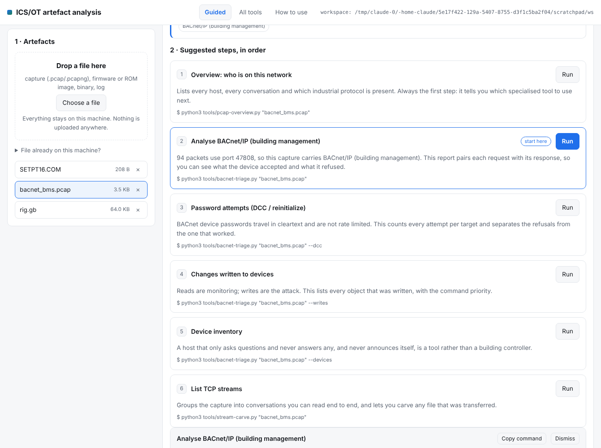
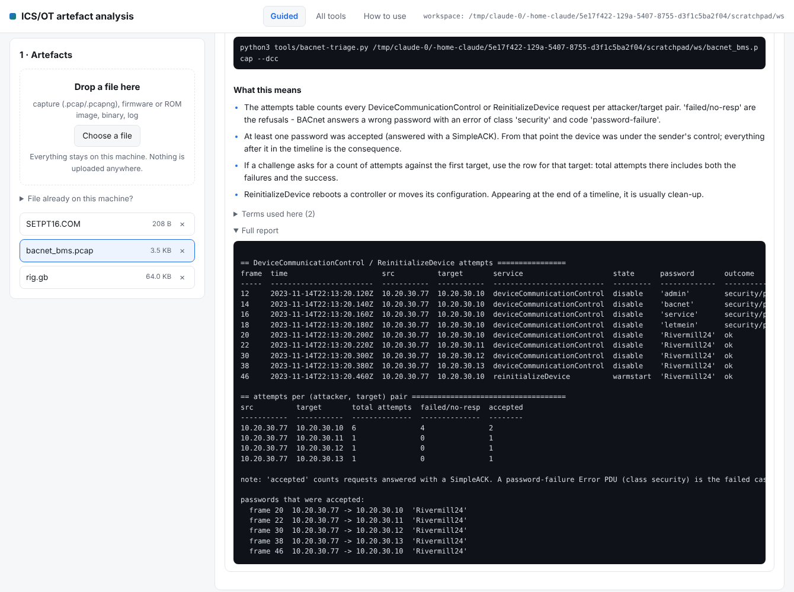
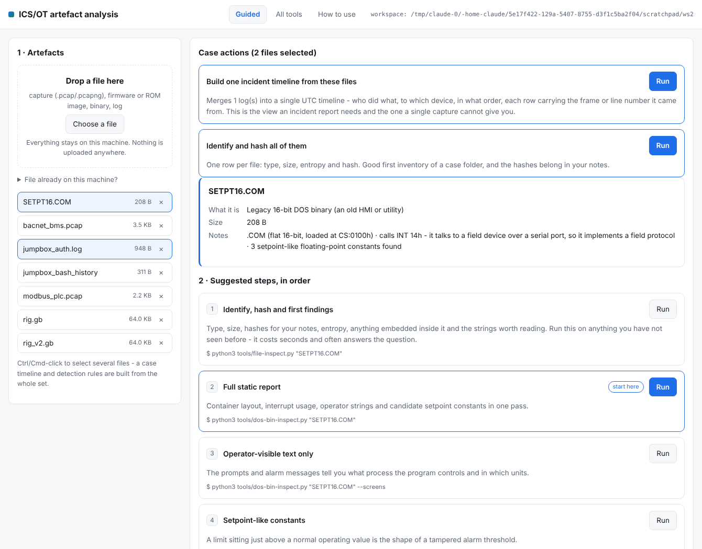

# ics-ctf-toolkit

Analysis tooling for OT/ICS artefacts: packet captures carrying industrial
protocols, firmware and cartridge images, and legacy HMI binaries.

Built while working through the kind of OT challenge set that ships a BACnet
capture of a building-management intrusion, an S7comm capture of a water
treatment plant, an IEC-104 client binary and a plant simulator packed into a
Game Boy ROM. The tools answer the questions those artefacts raise - *who
issued which command, to which point, with what value, and did the device
accept it* - and the `docs/` directory explains the engineering behind each
protocol so the answers mean something.

**No challenge data, no flags and no solutions are included.** The fixtures
under `tests/` are hand-built synthetic packets whose field values are known,
so every decoder can be verified against ground truth.

## Why

Wireshark already dissects these protocols. What it does not do is give you a
diffable, citable table of *the twelve things that mattered* in a 40 000-packet
capture - request/response pairing with success and failure separated, a
register map, a select-before-operate audit, an SZL fingerprinting summary.
That is the gap these scripts fill, and they do it with no dependencies, so
they run on an air-gapped analysis box with a stock Python.

## Requirements

Python 3.9+. No required third-party packages: the pcap/pcapng reader, every
protocol decoder and the web interface are implemented in the standard
library. It runs on an air-gapped analysis box with a stock Python.

Optional: `capstone` for 16-bit disassembly in `dos-bin-inspect.py`.

```bash
git clone https://github.com/lindseynguyen/Ics-toolkit
cd Ics-toolkit
python3 tests/make_fixtures.py fixtures/     # synthetic artefacts to practise on
python3 gui/serve.py                         # graphical interface, or:
python3 tools/pcap-overview.py fixtures/bacnet_bms.pcap
```

## Graphical interface

```bash
python3 gui/serve.py
```

Opens a local page on 127.0.0.1. Drop an artefact on it and the interface
identifies it by content, proposes the analysis steps **in the order a
responder would run them**, runs the real CLI tools, and explains each result
in plain language. No install, no internet, nothing leaves the machine.



Every step says *why* it matters before you run it, and every result shows the
exact command that produced it - so the interface teaches the command line
instead of hiding it.



Select several artefacts and **Case actions** appear: build one incident
timeline from the whole set, generate detection rules, merge a fragmented
capture set, or compare two binaries.



Three tabs: **Guided** (identification and the ordered plan), **All tools**
(every script with every option), **How to use** (method and glossary).
Full detail in [`docs/gui-guide.md`](docs/gui-guide.md); a forty-minute
hands-on walkthrough for a complete beginner, using the synthetic fixtures, is
in [`docs/getting-started.md`](docs/getting-started.md).

The terminal equivalent of guided mode:

```bash
python3 tools/triage-plan.py evidence/*
```

## Tools

**Case-level**

| Tool | Purpose |
|---|---|
| `tools/timeline.py` | one UTC timeline from every artefact in a case - captures, auth logs, shell history, CSV exports - each row carrying the frame or line number it came from |
| `tools/make-rules.py` | turn what a capture shows into deployable Suricata, Zeek and Sigma rules, with the host allow-lists inferred and the attacker excluded from them |
| `tools/triage-plan.py` | identify any set of artefacts and print the recommended order of analysis, with the commands ready to paste |
| `tools/pcap-overview.py` | first pass on any capture: hosts, conversations, protocol identification, scan heuristics, fragmentation warning |
| `tools/bacnet-triage.py` | BACnet/IP: device inventory, service usage, DeviceCommunicationControl / ReinitializeDevice password attempts with accepted-vs-failed counts, writeProperty targets and priorities |
| `tools/s7-triage.py` | S7comm / S7comm-plus: endpoints and roles, SZL diagnostic reads, block upload/download, CPU STOP and why it was refused, IEEE-754 tag writes |
| `tools/modbus-triage.py` | Modbus/TCP: function-code inventory, register and coil map, write operations, exception trails, scan heuristics, float word-order reconstruction, ASCII in registers |
| `tools/iec104-triage.py` | IEC 60870-5-104: APCI session state, ASDU inventory, IOA map, control-direction timeline, select-before-operate audit |
| `tools/dnp3-triage.py` | DNP3: link-layer addressing, application function codes, IIN flags, CROB and analog-output command decoding |
| `tools/cleartext-creds.py` | credentials in the clear: FTP, Telnet, HTTP Basic and form fields, SNMP communities, mail AUTH, LDAP simple bind, MS SQL Server TDS LOGIN7 (including the nibble-swap + XOR 0xA5 password field) |
| `tools/pcap-merge.py` | stitch fragmented capture sets into one time-ordered pcap |
| `tools/stream-carve.py` | TCP stream index, stream export, magic-based file carving |
| `tools/gb-cart-inspect.py` | Game Boy cartridge images: header, mapper, checksum tampering, per-bank entropy and string profile, embedded archive detection |
| `tools/dos-bin-inspect.py` | 16-bit `.COM` / MZ `.EXE`: container layout, operator strings, DOS/BIOS interrupt usage (INT 14h = serial field protocol), setpoint-like IEEE-754 constants, optional disassembly |
| `tools/blob-carve.py` | any binary: magic scan, decompression, entropy profile, single-byte-XOR container recovery, extraction |

**General-purpose forensic and reverse-engineering helpers** - `file`, `strings`, `xxd`, `diff` and `base64 -d`, with OT knowledge built in and output that says what it means ([details](docs/forensic-tools.md))

| Tool | Purpose |
|---|---|
| `tools/file-inspect.py` | what is this file: type by content, hashes, entropy with a plain reading of it, embedded containers, classified strings, suggested next commands |
| `tools/strings-plus.py` | strings with offsets and UTF-16 support, grouped into addresses, paths, commands, credential-like text, OT vocabulary and Siemens block names |
| `tools/hexview.py` | hex view at any offset, and a byte search that shows every hit in context (and tells you when the text exists as UTF-16 instead) |
| `tools/bin-diff.py` | compare two builds and interpret each change: a relabelled message, a setpoint moved from 1.5 to 9.75, a rebuilt checksum |
| `tools/decode.py` | decode base64/base32/hex/URL/gzip/zlib/ROT13/UTF-16/single-byte-XOR without guessing which one, following nested encodings |

Every tool is `--help`-documented and prints plain tables, so output pipes into
`grep`, `diff` and a report.

## Library

The CLIs are thin; the decoders are importable.

```python
from icsctf import pcapio, bacnet

packets = pcapio.read_many(["frag_01.pcap", "frag_02.pcap"])
messages = bacnet.extract(packets)
results = bacnet.correlate(messages)          # request -> ack / error

for key, res in results.items():
    req = res["request"]
    if req.service == "deviceCommunicationControl":
        print(req.frame, req.src, req.dst, req.password, res["outcome"])
```

| Module | Contents |
|---|---|
| `icsctf.pcapio` | pcap + pcapng reader, Ethernet/VLAN/SLL/raw, IPv4/IPv6, TCP/UDP, TCP stream assembly |
| `icsctf.bacnet` | BVLC/NPDU/APDU, tag walker, object and property tables, request/response correlation |
| `icsctf.s7comm` | TPKT/COTP/S7 header, read-write items, SZL table, block filename decoding, S7comm-plus classification |
| `icsctf.modbus` | MBAP + PDU, request pairing, register map, scan heuristics |
| `icsctf.iec104` | APCI formats, ASDU types, information-object decoding, SBO audit |
| `icsctf.dnp3` | link-layer de-stuffing, transport assembly, application objects, CROB |
| `icsctf.creds` | cleartext credential patterns, TDS password de-obfuscation |
| `icsctf.carve` | magic scan, decompression, entropy profiling, XOR recovery |
| `icsctf.gbcart` | cartridge header, bank profiling, blob location |
| `icsctf.dosbin` | MZ/COM layout, interrupt scan, float constants |
| `icsctf.detect` | content-based artefact identification and step planning |
| `icsctf.explain` | plain-language interpretation of a report, and the glossary |
| `icsctf.timeline` | event extraction from captures and logs, merging, CSV/JSON/Markdown export |
| `icsctf.rules` | capture profiling and Suricata / Zeek / Sigma generation |
| `icsctf.forensics` | identification, hashing, strings, hex, byte diffing, decoders |

## Documentation

`docs/` is the point of the repository as much as the code is:

- [`getting-started.md`](docs/getting-started.md) - a hands-on first analysis
  for someone new to OT, start to finish, on the synthetic fixtures
- [`gui-guide.md`](docs/gui-guide.md) - the graphical interface: every screen,
  SSH use, what it will and will not do, troubleshooting
- [`00-challenge-map.md`](docs/00-challenge-map.md) - which technology each
  OT challenge family exercises, and where to start
- [`bacnet-ip.md`](docs/bacnet-ip.md) - BVLC/NPDU/APDU, the object and
  property model, priority arrays, DCC as a denial-of-control primitive
- [`s7comm.md`](docs/s7comm.md) - ISO-on-TCP, function codes, DB addressing,
  the SZL table, block filenames, why a CPU STOP gets refused
- [`modbus-tcp.md`](docs/modbus-tcp.md) - framing, function codes, the
  addressing traps (zero-based, word order, ASCII in registers)
- [`iec-60870-5-104.md`](docs/iec-60870-5-104.md) - APCI formats, ASDU
  structure, select-before-operate, command ordering and interlocks
- [`dnp3.md`](docs/dnp3.md) - three layers, CRC de-stuffing, groups and
  variations, CROB, IIN flags
- [`firmware-artifacts.md`](docs/firmware-artifacts.md) - cartridge headers
  and bank layout, embedded archives, 16-bit HMI binaries
- [`attack-mapping.md`](docs/attack-mapping.md) - MITRE ATT&CK for ICS
  technique mapping, and what generalises
- [`timeline.md`](docs/timeline.md) - building one timeline from a whole case,
  how to read it, and the clock problems you will hit
- [`detection-rules.md`](docs/detection-rules.md) - how the allow-lists are
  inferred, what is covered, and what to check before deploying
- [`forensic-tools.md`](docs/forensic-tools.md) - the general-purpose helpers
  and how they fit the workflow
- [`large-captures.md`](docs/large-captures.md) - the size controls, and a
  workable order on a multi-gigabyte file
- [`workflow.md`](docs/workflow.md) - the triage order of operations, plus
  Wireshark display filters for the same questions
- [`defense-notes.md`](docs/defense-notes.md) - turning each observation into
  a control an operator can implement

## Scale

Every capture tool reads a file as a stream and keeps only the packets it will
decode, so a protocol report on a multi-gigabyte capture costs the memory of
the traffic it reports on, not of the file. All of them accept the same
controls:

```bash
python3 tools/pcap-overview.py huge.pcap --max-packets 200000
python3 tools/bacnet-triage.py huge.pcap --since 10:40 --until 11:10
python3 tools/modbus-triage.py odd-port.pcap --all-ports
```

See [`docs/large-captures.md`](docs/large-captures.md).

## Verifying the decoders

```bash
python3 tests/make_fixtures.py fixtures/
bash tests/run_all.sh fixtures/
python3 tests/check_rule_offsets.py fixtures/
```

`check_rule_offsets.py` matters: it asserts that the byte offsets the generated
Suricata rules rely on actually match real traffic, because a rule that never
fires is worse than no rule.

`make_fixtures.py` builds synthetic BACnet, S7comm, Modbus, IEC-104, DNP3 and
TDS captures plus a Game Boy ROM with an embedded zlib archive and a `.COM`
HMI binary, all with known field values. `run_all.sh` runs every tool against
them.

## Scope and intent

Defensive analysis: reading artefacts, understanding protocol behaviour,
turning both into detections and hardening. Nothing here generates traffic
toward a device, brute-forces anything, or alters a controller. Use it on
captures and files you are authorised to analyse.

## Licence

MIT - see [LICENSE](LICENSE).
